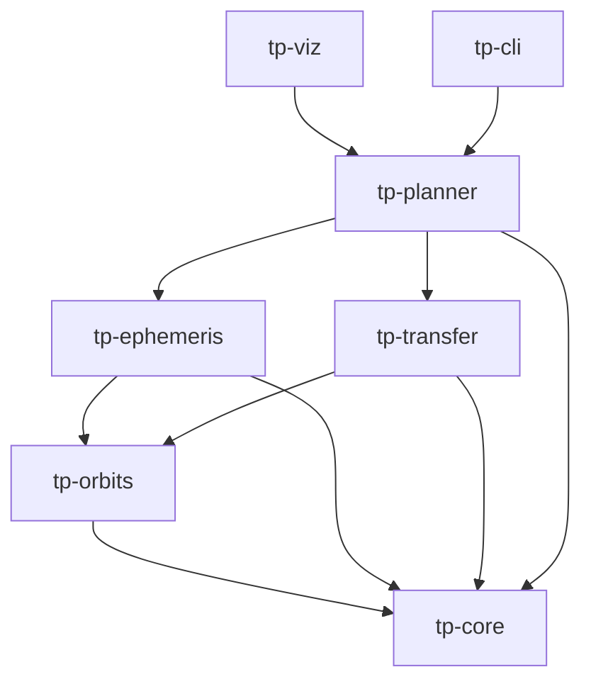
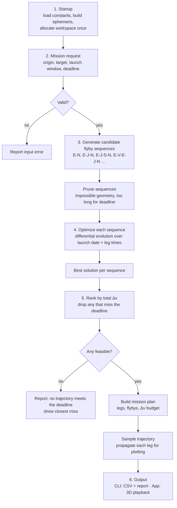
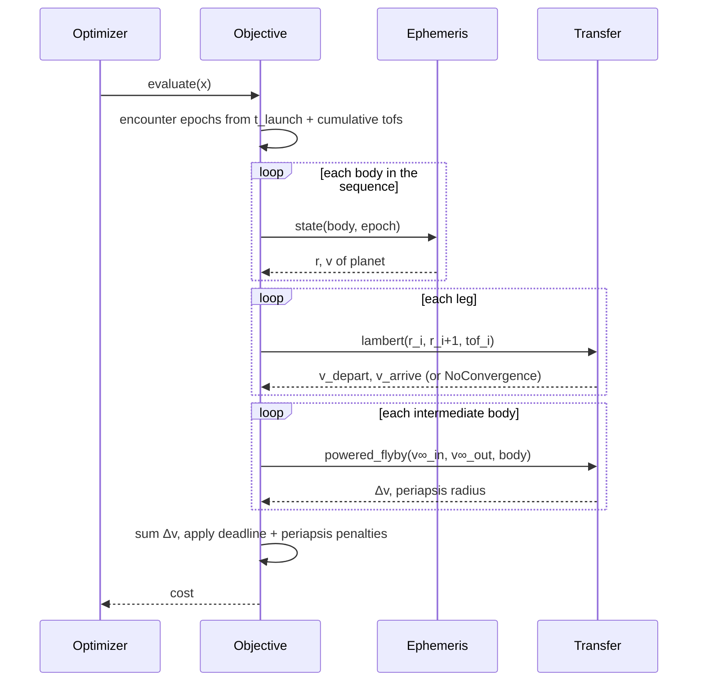
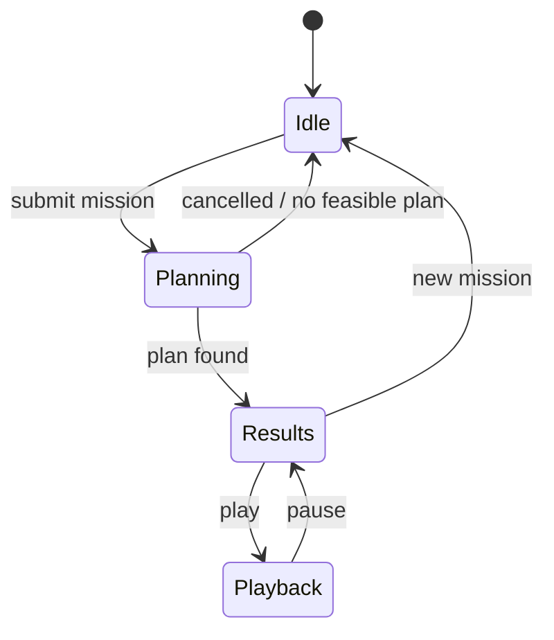

# Trajectory Planner

A from-scratch Rust interplanetary trajectory planner. Pick a departure body, a destination, a launch window and an arrival deadline; the planner searches launch dates, transfer times and gravity-assist sequences for the lowest-Δv trajectory that arrives on time, then plays it back in 3D.

**Fidelity:** patched conics (two-body legs joined at planetary flybys), analytic planetary ephemeris. High-fidelity refinement (N-body, DE440) is a stretch goal.

**Ground rules**

- All core code is written by hand: physics, math, solvers, optimizer.
- **No dynamic allocation in the engine.** Engine crates are `#![no_std]` without `alloc`, so allocating is a compile error, not a code-review item. See [Memory model](#memory-model).
- No Nyx or ANISE until the stretch phase (P7); they may be used as an *oracle* to check results before then.
- Everything follows the [10 coding rules](#coding-rules).

---

## Status

| Phase | Scope | Points | Status |
| --- | --- | --- | --- |
| P0 | Foundations: workspace, `Vec3`, units, time | 5 | In progress |
| P1 | Two-body propagator (RK4, RK45, leapfrog) | 9 | Not started |
| P2 | Kepler's equation, orbital elements | 9 | Not started |
| P3 | Analytic planetary ephemeris | 5 | Not started |
| P4 | Hohmann, Lambert, porkchop plots | 15 | Not started |
| P5 | Gravity assists, optimizer, sequence search | 24 | Not started |
| P6 | Real-time 3D visualization and app | 10 | Not started |
| P7 | Stretch: DE440, N-body, CR3BP, low thrust | 30 | Not started |

Full task list with story points: [`BACKLOG.md`](BACKLOG.md).

---

## Repository layout

The tree below is the target layout. The **Phase** column in the crate table says when each piece appears. At P0 you only need the root files, `tp-core` and a stub `tp-cli`.

```text
trajectory-planner/
├── Cargo.toml                 # workspace manifest: members, shared lints, profiles
├── Cargo.lock                 # committed
├── rust-toolchain.toml        # pin the stable toolchain
├── clippy.toml                # lint thresholds (too-many-lines = 60)
├── rustfmt.toml
├── README.md
├── BACKLOG.md
├── .github/workflows/ci.yml   # fmt, clippy -D warnings, test
│
├── docs/
│   ├── rules.md               # the 10 coding rules, with examples
│   ├── conventions.md         # units, frames, time scales, sign conventions
│   ├── derivations/           # your own notes: Kepler, Lambert, flyby math
│   └── decisions/             # short design records, one per decision
│       └── 0001-no-external-astro-libs-until-p7.md
│
├── data/
│   ├── horizons/              # reference state vectors exported from JPL Horizons (tests only)
│   └── gtop/                  # GTOP benchmark definitions + best-known solutions
│
├── missions/                  # mission request files (P5+)
│   ├── earth_mars_2031.toml
│   └── earth_neptune.toml
│
├── out/                       # generated CSVs and plots (git-ignored)
│
└── crates/
    ├── tp-core/               # P0 — shared types, no physics
    │   └── src/
    │       ├── lib.rs         # #![no_std]
    │       ├── math.rs        # the only file that touches libm: sqrt, sin, acos, atan2 …
    │       ├── array_vec.rs   # your own fixed-capacity vector, ArrayVec<T, N>
    │       ├── vec3.rs        # Vec3: add, sub, scale, dot, cross, norm, unit
    │       ├── units.rs       # Km, Seconds, KmPerS, Radians, Mu newtypes
    │       ├── time.rs        # Epoch (TDB seconds since J2000), Julian date conversions
    │       ├── constants.rs   # μ values, planet radii, AU, J2000 epoch
    │       ├── state.rs       # Position, Velocity, State
    │       └── error.rs
    │
    ├── tp-orbits/             # P1–P2 — two-body dynamics
    │   ├── src/
    │   │   ├── lib.rs
    │   │   ├── dynamics.rs    # two-body acceleration a = −μr/|r|³
    │   │   ├── integrators/
    │   │   │   ├── mod.rs     # Integrator trait
    │   │   │   ├── rk4.rs
    │   │   │   ├── rk45.rs    # Dormand–Prince, adaptive step
    │   │   │   └── leapfrog.rs
    │   │   ├── kepler.rs      # Kepler's equation (elliptic + hyperbolic)
    │   │   ├── elements.rs    # OrbitalElements ⇄ State
    │   │   ├── propagate.rs   # analytic Kepler propagation
    │   │   └── error.rs
    │   └── tests/
    │       ├── two_body_invariants.rs
    │       └── element_roundtrip.rs
    │
    ├── tp-ephemeris/          # P3 — where is each body at time t
    │   ├── src/
    │   │   ├── lib.rs         # Ephemeris trait
    │   │   ├── body.rs        # Body enum: Sun, Mercury … Neptune
    │   │   ├── analytic.rs    # JPL approximate Keplerian elements
    │   │   ├── frames.rs      # ecliptic ⇄ equatorial J2000
    │   │   └── error.rs
    │   └── tests/
    │       └── horizons.rs
    │
    ├── tp-transfer/           # P4–P5 — single-leg and flyby math
    │   ├── src/
    │   │   ├── lib.rs
    │   │   ├── hohmann.rs
    │   │   ├── lambert/
    │   │   │   ├── mod.rs     # common types, solver selection
    │   │   │   ├── universal.rs
    │   │   │   └── izzo.rs
    │   │   ├── hyperbola.rs   # v∞, C3, departure/arrival Δv
    │   │   ├── soi.rs         # sphere of influence
    │   │   ├── flyby.rs       # unpowered + powered flyby
    │   │   └── error.rs
    │   └── tests/
    │       └── lambert_cases.rs
    │
    ├── tp-planner/            # P4–P5 — search and optimization
    │   ├── src/
    │   │   ├── lib.rs
    │   │   ├── mission.rs     # MissionRequest: origin, target, window, deadline
    │   │   ├── sequence.rs    # flyby sequences, generation and pruning
    │   │   ├── decision.rs    # decision vector: launch epoch + leg times of flight
    │   │   ├── objective.rs   # decision vector → cost (total Δv) + constraints
    │   │   ├── porkchop.rs    # grid search for one leg
    │   │   ├── optimizer/
    │   │   │   ├── mod.rs     # Optimizer trait
    │   │   │   ├── de.rs      # differential evolution
    │   │   │   └── rng.rs     # seeded PRNG (xorshift / PCG) for reproducibility
    │   │   ├── result.rs      # MissionPlan: legs, flybys, Δv budget
    │   │   └── error.rs
    │   └── tests/
    │       └── gtop_cassini1.rs
    │
    ├── tp-cli/                # P0 stub, grows each phase — runs milestones, exports CSV
    │   ├── src/
    │   │   ├── main.rs
    │   │   ├── workspace.rs   # allocates all engine buffers once at startup
    │   │   ├── commands/      # propagate, ephemeris, porkchop, plan
    │   │   └── export.rs      # CSV writers
    │   └── tests/
    │       └── zero_alloc.rs  # counting allocator: planner run allocates nothing after setup
    │
    └── tp-viz/                # P6 — Bevy or wgpu front end
        └── src/
            ├── main.rs
            ├── workspace.rs   # same as tp-cli: engine buffers allocated once
            ├── scene.rs       # Sun, planets, orbit lines
            ├── playback.rs    # time warp, play/pause
            ├── ui.rs          # mission input panel
            └── planner_task.rs # runs the planner off the render thread
```

> **Naming note:** don't name a crate `core`. That collides with Rust's built-in `core` library. Hence the `tp-` prefix; rename it freely.

### Crates at a glance

| Crate | Phase | Profile | `std`? | Depends on | Owns |
| --- | --- | --- | --- | --- | --- |
| `tp-core` | P0 | Engine | `no_std`, no `alloc` | `libm` | Vectors, units, epochs, constants, `State`, `ArrayVec` |
| `tp-orbits` | P1–P2 | Engine | `no_std`, no `alloc` | core | Dynamics, integrators, Kepler, elements |
| `tp-ephemeris` | P3 | Engine | `no_std`, no `alloc` | core, orbits | `Ephemeris` trait, planet positions |
| `tp-transfer` | P4–P5 | Engine | `no_std`, no `alloc` | core, orbits | Lambert, hyperbolas, flybys |
| `tp-planner` | P4–P5 | Engine | `no_std`, no `alloc` | core, ephemeris, transfer | Mission model, objective, optimizer |
| `tp-cli` | P0+ | Edge | `std` | all above | Command line, file I/O, CSV export, buffer setup |
| `tp-viz` | P6 | Edge | `std` | all above | Rendering, UI, playback |

**Engine** crates follow all 10 rules, never allocate, and have exactly one third-party dependency: `libm`, a pure-Rust, allocation-free math library (MIT/Apache). It's needed because `sqrt`, `sin`, `acos` and `atan2` live in `std`, not `core`. Only `tp-core` depends on it directly and re-exports the functions it uses, so swapping it out later touches one file.

**Edge** crates handle I/O and UI. They may use dependencies such as `serde`, `toml` and `bevy`, and may allocate, but they allocate every buffer the engine needs **once, at startup**.

### Dependency graph

Arrows point from a crate to what it depends on. Nothing points upward: physics never knows about the planner, and the planner never knows about rendering.



---

## Conventions

These live in `docs/conventions.md` and apply everywhere. Writing them down before any code exists prevents the silent unit and frame bugs that are hardest to find later.

| Quantity | Convention |
| --- | --- |
| Distance | kilometres (`Km`) |
| Velocity | km/s (`KmPerS`) |
| Time span | seconds (`Seconds`) |
| Gravitational parameter | km³/s² (`Mu`) |
| Angles | radians internally; degrees only at input/output |
| Epoch | TDB seconds since J2000 (2000-01-01 12:00:00 TDB) |
| Reference frame | heliocentric ecliptic J2000, unless a type says otherwise |
| Float type | `f64` for all physics; `f32` only for rendering |
| Float math | through `tp_core::math`, never `libm` directly |
| Capacities | named `const`s in one place (`MAX_FLYBYS`, `POP_SIZE`, …), passed as const generics |
| Errors | each crate has its own error enum; no panics in engine crates |

**Simplification to document:** until P7, treat UTC ≈ TDB. They differ by about 69 s, which is negligible for patched-conic planning. Add a note where the shortcut lives so you can find it later.

---

## Memory model

The engine never allocates. Every size is bounded at compile time, and anything too big for the stack is a buffer the caller owns and lends to the engine.

### Bounds, decided up front

| Constant | Starting value | Bounds |
| --- | --- | --- |
| `MAX_FLYBYS` | 4 | Bodies per sequence (sequence length = `MAX_FLYBYS + 2`) |
| `MAX_SEQUENCES` | 256 | Candidate sequences after pruning |
| `POP_SIZE` | 64 | Differential-evolution population |
| `MAX_GENERATIONS` | 2,000 | Optimizer iterations per sequence |
| `MAX_KEPLER_ITERS` | 50 | Newton steps in Kepler's equation |
| `MAX_LAMBERT_ITERS` | 35 | Householder steps in Izzo's solver |
| `SAMPLES_PER_LEG` | 512 | Points sampled per leg for plots and playback |

Values are a first guess. They live in one `limits.rs` so tuning is a one-line change.

### Rules of the pattern

1. **Small data lives on the stack.** `Vec3`, `State`, `OrbitalElements` and one `Sequence` (an `ArrayVec<Body, 6>`) are a few hundred bytes at most.
2. **Large data is lent in by the caller.** Porkchop grids, the optimizer population and sampled trajectories arrive as `&mut [T]` or `&mut Workspace`. The engine fills them and returns how many entries it used.
3. **Too many results is an error, not a reallocation.** If a fixed-capacity container fills, return `Err(CapacityExceeded { limit })`.
4. **Edge crates allocate once.** `workspace.rs` builds every buffer at startup, sized from the constants above, and reuses them for every mission.

Why rule 2 matters: a local `[[f64; 1000]; 1000]` porkchop grid is 8 MB, which overflows the 8 MB main-thread stack, never mind a 2 MB worker thread.

### Shape of a buffer-based API

```rust
// Engine: no allocation, fills what it's given.
pub fn porkchop(
    eph: &impl Ephemeris,
    req: &PorkchopRequest,
    out: &mut [f64],                        // rows × cols, row-major
) -> Result<GridShape, PlannerError>;

// Edge: allocates once, lends forever.
pub struct Workspace {
    pub porkchop: Box<[f64]>,               // sized at startup
    pub population: Box<[Candidate]>,
    pub samples: Box<[State]>,
}
```

### Verifying it

- **Compile time:** engine crates are `#![no_std]` and don't declare `extern crate alloc`, so `Vec`, `Box` and `String` don't exist there.
- **Run time:** `tp-cli/tests/zero_alloc.rs` installs a counting global allocator. It builds the workspace, resets the counter, runs a full plan, and asserts the count is still zero. That also catches allocations hiding in edge code on the hot path.

---

## Key interfaces (sketches)

These are shapes to design around, not code to copy. Rename and reshape them as your understanding grows.

```rust
// tp-core
pub struct ArrayVec<T, const N: usize> { items: [T; N], len: usize }   // push → Err when full
pub struct Vec3 { pub x: f64, pub y: f64, pub z: f64 }
pub struct Km(pub f64);
pub struct Seconds(pub f64);
pub struct Epoch { tdb_seconds_since_j2000: f64 }
pub struct State { pub r: Vec3 /* km */, pub v: Vec3 /* km/s */ }

// tp-orbits
pub trait Integrator {
    fn step(&self, state: State, dt: Seconds, mu: Mu) -> Result<State, OrbitError>;
}
pub fn solve_kepler(mean_anomaly: Radians, e: Eccentricity) -> Result<Radians, OrbitError>;
pub fn state_to_elements(state: &State, mu: Mu) -> Result<OrbitalElements, OrbitError>;
pub fn elements_to_state(el: &OrbitalElements, mu: Mu) -> State;

// tp-ephemeris
pub trait Ephemeris {
    fn state(&self, body: Body, epoch: Epoch) -> Result<State, EphemerisError>;
}

// tp-transfer
pub fn lambert(r1: Vec3, r2: Vec3, tof: Seconds, mu: Mu, way: TransferWay)
    -> Result<LambertSolution, TransferError>;          // returns v1, v2
pub fn powered_flyby(v_inf_in: Vec3, v_inf_out: Vec3, body: Body)
    -> Result<FlybyResult, TransferError>;              // returns Δv, periapsis radius

// tp-planner
pub struct MissionRequest {
    pub origin: Body,
    pub target: Body,
    pub launch_window: (Epoch, Epoch),
    pub arrive_by: Epoch,
    pub max_flybys: u8,
}
pub type Sequence = ArrayVec<Body, { MAX_FLYBYS + 2 }>;
pub trait Optimizer {
    fn minimize(
        &mut self,
        problem: &impl Problem,
        population: &mut [Candidate],    // lent by the caller, len == POP_SIZE
    ) -> Result<Solution, PlannerError>;
}
pub fn sample_plan(plan: &MissionPlan, out: &mut [State]) -> Result<usize, PlannerError>;
```

---

## Program lifecycle

The program runs in six stages. Stages 1–5 make up the planner and run the same way from the CLI or the app. Stage 6 differs: the CLI exports files, while the app renders and plays back.

### Overview



### 1. Startup

- Load physical constants and body data (μ, radius, minimum safe flyby altitude).
- Construct the ephemeris (`AnalyticEphemeris` now, a DE440 backend in P7). Every later stage depends only on the `Ephemeris` trait.
- Read configuration such as the optimizer seed.
- **Allocate the workspace.** The edge crate builds every engine buffer (population, porkchop grid, trajectory samples) at its maximum size. This is the only allocation in the program's life; every later stage reuses these buffers.

### 2. Mission request

- Input comes from CLI flags or a `missions/*.toml` file, and later from the app's UI.
- Validate at the boundary: launch window start < end < deadline, origin ≠ target, and every value finite. Invalid requests never reach the planner.

### 3. Sequence generation and pruning

- Enumerate flyby sequences up to `max_flybys` using a bounded, explicit stack (rule 7: no recursion). Sequences go into an `ArrayVec<Sequence, MAX_SEQUENCES>`; overflowing it is an error.
- Prune cheaply before optimizing, for example sequences whose minimum Hohmann-style times already exceed the deadline. This follows Ceriotti's leg-by-leg pruning idea.

### 4. Optimization (the inner loop)

Each sequence becomes a fixed-size optimization problem:

- **Decision vector:** `x = [t_launch, tof₁, tof₂, …, tofₙ]`
- **Cost:** `Δv_departure + Σ Δv_flyby + Δv_arrival`
- **Constraints:** `t_launch + Σ tofᵢ ≤ arrive_by`, and flyby periapsis ≥ the body's minimum safe radius

The optimizer proposes many `x` values. Each one is evaluated like this:



A Lambert failure or a NaN does not stop the search. It makes that candidate infeasible (a large penalty cost), and the optimizer moves on.

### 5. Ranking and the mission plan

- Keep the best solution per sequence and discard any that miss the deadline.
- Sort by total Δv, breaking ties by arrival time. The output is a `MissionPlan`: ordered legs, flyby epochs and altitudes, and a Δv budget per event.
- *(P7)* Refine the best plan with a full N-body integration, using the patched-conic answer as the starting guess.

### 6. Output

**CLI:** writes `out/<mission>/plan.txt` (human-readable report) plus CSVs for the trajectory, planet tracks and porkchop grids.

**App (P6):** the planner runs on a worker thread, so the UI never blocks.



During playback, each frame converts the time-warped clock into an `Epoch`, queries the ephemeris for planet positions, and samples the spacecraft position along the current leg. The planner's results land in the preallocated workspace, so a new mission reuses the same memory.

---

## Milestone demos

Each phase ends with something you can run and check against a known answer.

| Phase | Command (planned) | Check against |
| --- | --- | --- |
| P1 | `cargo run -p tp-cli -- propagate --body earth --days 365` | Period ≈ 365.25 d; energy drift < 1e-10 |
| P2 | `cargo run -p tp-cli -- elements --body mars` | Round trip state → elements → state |
| P3 | `cargo run -p tp-cli -- ephemeris --body neptune --date 2030-01-01` | JPL Horizons vectors in `data/horizons/` |
| P4 | `cargo run -p tp-cli -- porkchop --from earth --to mars --window 2031` | Published Earth–Mars porkchop plots |
| P5 | `cargo run -p tp-cli -- plan missions/earth_neptune.toml` | GTOP Cassini1 best-known; Voyager 2 flight time ≈ 12 years |
| P6 | `cargo run -p tp-viz` | Visual: orbits close, flybys line up with planets |

---

## Testing strategy

| Kind | What it proves | Example |
| --- | --- | --- |
| Unit | One function on known input | `Vec3::cross` of x̂ and ŷ is ẑ |
| Invariant | The physics is respected | Energy and angular momentum stay constant over 1,000 orbits |
| Reference | Matches the real world | Earth position vs Horizons within 0.01 AU |
| Round trip | Conversions are inverses | elements → state → elements |
| Benchmark | The whole pipeline works | GTOP Cassini1 within a few % of the best known |
| Zero allocation | The memory model holds | Counting allocator reads 0 across a full plan |

Reference data in `data/` is committed, so tests never touch the network.

---

## Coding rules

The starter set (details and examples in `docs/rules.md`):

1. Handle every result; no `unwrap()`.
2. Every loop has a bound.
3. Newtypes for physical quantities.
4. Never compare floats with `==`.
5. Check outputs are finite.
6. No unchecked indexing.
7. No recursion.
8. No `unsafe`.
9. Zero warnings.
10. Test the physics, not just the code.

Plus the project-wide rule behind the [memory model](#memory-model): **engine crates never allocate.** `no_std` without `alloc` enforces it at compile time.

**Testing note:** `#![no_std]` applies to the library, not its tests. Tests can use `std` freely with `#![cfg_attr(not(test), no_std)]`, which is handy for printing during debugging.

---

## Build and run

```bash
cargo build --workspace
cargo test --workspace
cargo clippy --workspace --all-targets -- -D warnings
cargo fmt --all --check
```

---

## References

- Curtis, *Orbital Mechanics for Engineering Students* — primary text (ch. 2–5, 8)
- Vallado, *Fundamentals of Astrodynamics and Applications* — reference
- Izzo, "Revisiting Lambert's Problem" (2014), arXiv:1403.2705
- ESA GTOP database — benchmark problems and best-known solutions
- Vasile & De Pascale, "On the Preliminary Design of Multiple Gravity-Assist Trajectories", arXiv:1105.1822
- Ceriotti, *Global Optimisation of Multiple Gravity Assist Trajectories* (PhD thesis, Glasgow, 2010)
- JPL Horizons — reference ephemeris data
- JPL "Approximate Positions of the Planets" — Keplerian elements for the analytic ephemeris
